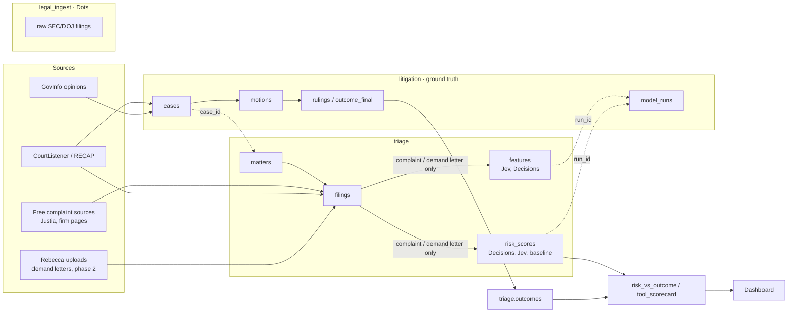

# Risk triage: target Supabase layout

**Goal.** Score how risky an inbound complaint or demand letter is, cheaply, with Decisions and Jev. A reasoning model (GPT or Claude) is the baseline. "Risk" is tied to real outcomes: **did any claim survive a 12(b)(6) motion to dismiss?** Later outcome signals: class certification, MSJ, settlement.

**Phases.** Phase 1 scores complaints against 12(b)(6) outcomes. Phase 2 is a separate proof of concept for demand letters, which usually come before a complaint: it scores them and checks against what happened next (no complaint filed, settled, or filed and survived).

## Schemas (one project: yhaahsrevxueogdwxxtl)

| Schema | Purpose | Owner | Action |
|---|---|---|---|
| `legal_ingest` | Dots' raw SEC/DOJ filings intake (27 docs) | **Dots** | Leave as is. 003b rename waits on Dots. |
| `litigation` | **Ground truth**: cases, motions, rulings, outcome labels, `model_runs` (provenance for every tool run) | these scripts | Keep. Don't move or rename. 004, 005 and 006 already target it. |
| `triage` (new, 007) | **Inbound side**: `matters`, `filings` (complaint, motion, ruling, demand letter), `features`, `risk_scores`, plus the views `outcomes`, `risk_vs_outcome` and `tool_scorecard` | these scripts | Create. |
| `public` | Legal Doc Catalog demo (89 dummy docs) | Rebecca | Leave as is. Archive later if unused: `ALTER SCHEMA` to `archive_catalog`, or a dump. Nothing in triage depends on it. |

Why not rename `litigation`? 004 to 006, the dashboard views and the batch loaders all point at it. A ruling is an *outcome*, so the name still fits. `triage` links to it by `case_id`, so no data moves.

`litigation.predictions` stays for the old "read the ruling" experiments. New work writes to `triage.features` and `triage.risk_scores`.

## Flow

**No leakage.** `filings.is_model_input` is true only for complaints, amended complaints and demand letters. The runner's `complaints` loader refuses anything else, and anything whose text looks like a court order.

## Manual vs scheduled (no continuous pulls)

| Step | How it runs | Who |
|---|---|---|
| Pull rulings and complaints (CourtListener, GovInfo, free sources) | **Manual**, one batch at a time; output is a reviewed SQL load file | these scripts, then Rebecca runs it via Claude |
| Upload demand letters | Manual | Rebecca |
| Feature extraction and risk scoring | **Manual**: `framework/run.py config.*.json` | these scripts |
| Outcome check and dashboard | Views; always current, nothing to schedule | Supabase |
| One-off wait for a rate limit (e.g. CourtListener batch 2) | A single scheduled check, not a recurring job | assistant |
| SEC/DOJ intake into `legal_ingest` | Dots' pipeline, on Dots' schedule | **Dots** |

Dots owns `legal_ingest` and anything that writes to it. These scripts never write to `legal_ingest` or `public`. If Dots' filings later become triage inputs, add a view or copy into `triage.filings`. Don't share tables.

## Scoring "risk" for the proof of concept
- `p_survive`: the chance at least one claim survives 12(b)(6). `risk_tier`: high, medium or low.
- Check: a high tier should line up with `survived_12b6 = true` (`tier_matches_outcome`). `tool_scorecard` also reports a Brier score and cost per tool.
- With 5 to 10 cases this is a sanity check, not statistics. It shows whether the cheap tools track the baseline and the outcomes.
